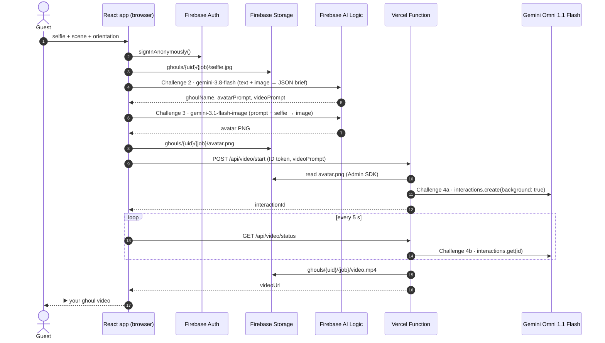

# Step 1 · Overview — what you're building

> 🧭 **Read this for the ideas.** The room follows the [workshop](15-workshop.md): concepts first, React last.
> The same path, with a diagram, is [Raise Your Own Haunt](16-raise-your-own-haunt.md) and on the booth at `/build`.
> ⏱️ 10 min · Formula E codelab: *1 · Introduction*

**The Haunted Kiosk** is a photo booth. A guest uploads a photo of one person or a group, picks a scene, and Gemini edits them into
a character — first as a portrait, then as an 8-second video. Faces stay. Clothes, props, and the room change. Halloween is the sample theme in this repo.
In the workshop you write your own scene, then ask Claude, Gemini, or Antigravity to build a **light** one-page app. [Make your own](13-make-your-own.md) is how you reskin this full kiosk afterwards.

It is the twin of Google's **Formula E GenMedia Kiosk** codelab. The *concept* and the *four challenges*
are the same. The *stack* is different:

## Concepts

These are the ideas. In the [workshop](15-workshop.md) you learn them before anyone opens a component. The files named here are this repo's reference implementation.

### A scene is a recipe, a brief is a script

A scene (`src/data/booth-scenes.ts` = backdrop × character) resolves to three strings: **costume** (who they become), **setting** (where),
and **motion** (what the camera and the character do for 8 seconds). That is deliberately short.
`buildBriefInstruction()` in `src/lib/briefPrompt.ts` hands the recipe and the photo to Gemini 3.8 Flash
and asks for a **brief**:

| Field | Who consumes it |
|---|---|
| `ghoulName` | The UI, as the title of the result |
| `personDescription` | The UI, so the guest can see what the model noticed |
| `avatarPrompt` | Challenge 3, Nano Banana 2 |
| `videoPrompt` | Challenge 4, Gemini Omni |

Challenge 2 forces that shape with **structured output**: `responseMimeType: 'application/json'` plus a
`responseSchema`. The pipeline then passes fields, not a blob of prose. Temperature stays low (`0.2`) so
the description stays close to the photo. Thinking level `HIGH` gives the model room to look at the people
before it writes.

### The photograph stays in the request

Both the brief and the portrait send the photo as an image part (`inlineData`), next to the text.
The photo may show one person or a group. Describing a face in words and hoping the image model invents
the same person is a different product. Image-to-image is why they still look like themselves.
The identity lock in `briefPrompt.ts`, `avatar.ts`, and `server/omni.ts` says what may change (clothing,
props, background, lighting) and what may not (face shape, eyes, skin, hair, glasses, expression, who is
in the frame). Costumes in `src/data/prompts.ts` are wardrobe, not a new skin colour or face paint that
covers features. The portrait call also sets
`responseModalities` so the model is allowed to return pixels, and `imageConfig.aspectRatio` so 9:16 and
16:9 are the frame the guest picked. Photos are downscaled to a long edge of 1920 so a group still has readable faces.

### Two ways of calling Gemini, on purpose

| Call | Where | Credential | Why here |
|---|---|---|---|
| Brief and portrait | Browser, Firebase AI Logic (`GoogleAIBackend`) | Firebase project, plus App Check | Finishes in seconds. Firebase attaches Gemini access. The key never enters the bundle. |
| Video | Vercel Function, `@google/genai` Interactions API | `GEMINI_API_KEY` | Omni is a long job and the Interactions API is called with a key you must not ship to the browser. |

Challenge 1 is only the first row: `getAI(app, { backend: new GoogleAIBackend() })`.
Challenge 4 is the second row.

`VITE_` variables are compiled into the browser bundle. `GEMINI_API_KEY` and
`FIREBASE_SERVICE_ACCOUNT_BASE64` have no `VITE_` prefix, so Vite keeps them on the server.

### The video loop lives in the browser

A Vercel function in this project is limited to about a minute. Omni can take longer, so the Python
lab's `while True: sleep(5)` cannot run inside the function. Challenge 4a calls `interactions.create`
with `background: true` and returns the `interactionId` immediately. Challenge 4b calls
`interactions.get` **once**. `waitForVideo()` in `src/lib/video.ts` is the loop: every 5 seconds it
asks `/api/video/status`. When the mp4 already exists in Storage, that call returns the URL again.

### Identity and locks

`ensureSignedIn()` calls `signInAnonymously()`. The uid becomes the folder name.

```
ghouls/{uid}/{jobId}/selfie.jpg    browser upload
ghouls/{uid}/{jobId}/avatar.png    browser upload
ghouls/{uid}/{jobId}/video.mp4     Admin SDK inside the function
```

`storage.rules` lets that uid read and write only their folder, and lets the browser upload images under
10 MB. The function writes the mp4 with the Admin SDK, which bypasses rules, but only after
`requireUser()` has verified the Firebase ID token and checked that the token's uid owns the path.

**App Check** is the lock on Firebase AI Logic. The proxy at `firebasevertexai.googleapis.com` rejects a
brief or portrait call that arrives without a valid App Check token (`401 … token is invalid`). Projects
that turned on AI Logic recently have this enforcement on already. How to satisfy it on localhost and in
production is [02 §2.8](02-firebase-setup.md#28-app-check--required-for-firebase-ai-logic).

### What you change, and what you leave

A new theme is new scenes, a rewritten art-director prompt, and new UI copy. The stage order in
`src/lib/pipeline.ts` (upload → brief → portrait → video), anonymous auth, the storage rules, and the
poll loop stay. Details: [Make your own](13-make-your-own.md).

- **No Python / FastAPI.** The browser talks to Gemini directly through **Firebase AI Logic**.
- **No Cloud Run / Docker.** The one piece that needs a secret key (Gemini Omni video) is a pair of
  **Vercel Functions** written in TypeScript.
- **No raw GCS bucket.** Files live in **Firebase Storage**, protected by security rules and Anonymous Auth.
- **No Cloud Shell Editor.** You code locally with **Gemini CLI** as your pair programmer.

## The pipeline



## Formula E → Halloween mapping

| Formula E lab (Python) | Haunted Kiosk (TypeScript) | File |
|---|---|---|
| TODO 1 `genai.Client(enterprise=True, …)` | **Challenge 1** `getAI(app, { backend: new GoogleAIBackend() })` | `src/lib/firebase.ts` |
| TODO 2 `client.interactions.create(model="gemini-3.8-flash", thinking_level="high")` | **Challenge 2** `getGenerativeModel(ai, { model: 'gemini-3.8-flash', thinkingConfig, responseSchema })` | `src/lib/promptExpansion.ts` |
| TODO 3 `client.models.generate_content("gemini-3.1-flash-image", response_modalities=["IMAGE"])` | **Challenge 3** same model through Firebase AI Logic `generateContent`, `responseModalities` + `imageConfig` | `src/lib/avatar.ts` |
| TODO 4a `interactions.create(model="gemini-omni-…", background=True)` | **Challenge 4a** `ai.interactions.create({ …, background: true })` in a Vercel Function | `server/omni.ts` |
| TODO 4b `while True: interactions.get(id); time.sleep(5)` | **Challenge 4b** one `interactions.get(id)` per request; the **browser** does the loop | `server/omni.ts`, `src/lib/video.ts` |
| `upload_to_gcs()` | `uploadBytes()` (browser) / Admin SDK `file.save()` (server) | `src/lib/storage.ts`, `server/firebaseAdmin.ts` |
| FastAPI `jobs_db` + `/api/job/{id}` | React state in `pipeline.ts` + `/api/video/status` | `src/lib/pipeline.ts` |
| `gcloud run deploy` ×2 | `vercel --prod` ×1 | — |

---
[⬅️ README](../README.md) · [Workshop ➡️](15-workshop.md) · [Raise Your Own Haunt](16-raise-your-own-haunt.md)
