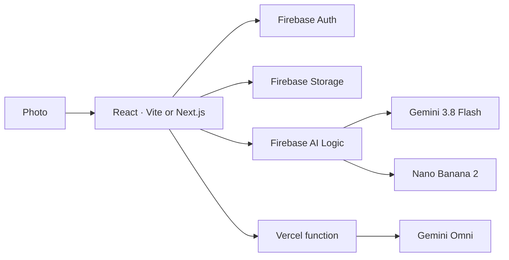

# Raise Your Own Haunt

> Build it yourself. About 2 hours.
> Same shape as the [Formula E GenMedia codelab](https://codelabs.developers.google.com/formula-e-genmedia-lab-codelab?hl=en#0). The ideas match. The stack is React, Firebase, and Vercel.
> The booth in this repo is the reference. You scaffold a new app from a prompt.

The same steps are on the live booth at `/build`.

## 0 · What you are raising

A guest uploads a photo of one person or a group, picks a scene, and gets a name, a portrait, and an eight-second video. The people stay recognisable. Clothes, props, and the room change.

**Concept — one photo, three jobs.** A text model writes a brief, an image model edits the photo, a video model animates that portrait.



Technologies: React, Vite or Next.js, Firebase, Gemini, Vercel. Event marks: AI DevCamp and GDG London.

## 1 · The ideas, before any file

A scene is three strings: **costume**, **setting**, **motion**. Costume is clothing, not a new face.

Gemini 3.8 Flash returns `ghoulName`, `personDescription`, `avatarPrompt`, and `videoPrompt`.

**Concept — structured output.** Temperature about 0.2, thinking high, JSON plus a schema.

**Concept — the photograph stays in the request.** The portrait call sends the photo bytes again.

Checkpoint: write one scene. You will paste it in step 3. Longer version: [Challenge 2](05-challenge-2-prompt-expansion.md).

## 2 · Two doors, and a lock on each

| Call | Where | Credential |
|---|---|---|
| Brief and portrait | Browser, Firebase AI Logic | Firebase project + App Check. No Gemini key in the page. |
| Video | Vercel function | `GEMINI_API_KEY`, no `VITE_` prefix |

**Concept — a guest is a uid.** Anonymous sign-in creates `ghouls/{uid}/{jobId}/`. The browser uploads images. The function writes `video.mp4` after it checks the ID token.

**Concept — App Check.** A missing token is a 401 even when the upload worked. Localhost uses a debug token. A public URL uses reCAPTCHA Enterprise. The debug token stays off Vercel.

You need Blaze for Storage, and Gemini Prepay credits. Blaze does not pay for Gemini. Setup: [prerequisites](01-prerequisites.md) and [Firebase](02-firebase-setup.md).

## 3 · Start from a prompt in your IDE

Create an empty folder. Open it in Cursor, VS Code, Claude, Gemini, or Antigravity. Choose **Vite + React** or **Next.js on Vercel**. Paste the brief. Do not attach `.env.local`.

```text
Build a light photo booth I can deploy on Vercel. I will choose the stack: Vite + React, or Next.js. Use Firebase for auth and storage, Firebase AI Logic in the browser, and one server route for video.

The photo may be one person or a group. Edit that photo. Do not invent new people.

Pipeline, in this order:
1. Anonymous Firebase sign-in.
2. Upload the photo to Firebase Storage at ghouls/{uid}/{jobId}/selfie.jpg (images only, under 10 MB).
3. gemini-3.8-flash via Firebase AI Logic. Input: my scene (costume, setting, motion) plus the photo bytes. Structured JSON only: ghoulName, personDescription, avatarPrompt, videoPrompt. Temperature 0.2, thinking high.
4. Identity lock in the brief and the portrait: same people, same count, same order. Do not change face shape, eyes, nose, mouth, skin tone, hair, glasses, or expression. Change only clothing, small props, background, and lighting.
5. gemini-3.1-flash-image (Nano Banana 2) via Firebase AI Logic. Input: avatarPrompt plus the same photo bytes. Return an image, 9:16 or 16:9.
6. Upload that portrait to ghouls/{uid}/{jobId}/avatar.png.
7. A server route starts Gemini Omni (gemini-omni-1.1-flash) with background: true using GEMINI_API_KEY (no VITE_ prefix). The page polls every 5 seconds. When the mp4 is ready, save it with the Admin SDK and play it. Faces in the video must not morph.

UI: one page. File or camera input, three scene buttons, one Generate button, status lines for upload, brief, portrait, and video, then the name, the portrait, and the video. No admin page, no watermarks, no print, no share sheet.

Read config from .env.local only. Never hard-code keys. Gitignore .env.local and any service-account JSON.

Scene to use:
<paste costume, setting, and motion>
```

## 4 · Four specialists

1. Firebase AI Logic client — [Challenge 1](04-challenge-1-firebase-ai-logic.md).
2. Gemini 3.8 Flash writes the brief — [Challenge 2](05-challenge-2-prompt-expansion.md).
3. Nano Banana 2 edits the photo — [Challenge 3](06-challenge-3-nano-banana-avatar.md).
4. Gemini Omni starts with `background: true`. The page polls — [Challenge 4](07-challenge-4-omni-video.md).

**Concept — video is a job, not a request.**

## 5 · One page

Keep the photo input, three scenes, one button, and the four status lines. Leave logos, captions, print, share, and `/admin` in this repo. The stage order stays: upload, brief, portrait, video. See [advanced level](14-advanced-level.md) after yours works.

## 6 · Ship it

Run a real photo, one person or a group. Deploy to Vercel. Add the hostname to Firebase Authorized domains and to the reCAPTCHA key. Redeploy after any `VITE_` change.

Usual failures: App Check `401`, Prepay `429`. See [troubleshooting](11-troubleshooting.md) and [deploy](09-deploy-vercel.md).

Done when you can say why the video call is on the server and the brief call is not.

## Congratulations

You raised a haunt.

- A scene is a recipe. A brief is the contract between three models.
- The photo stays in the request.
- The browser may call Firebase AI Logic. Only the server holds the Gemini key.
- Video is a background job.
- App Check is the lock on a public site.

---

[⬅️ Workshop](15-workshop.md) · [Overview](00-overview.md) · [Troubleshooting](11-troubleshooting.md)
